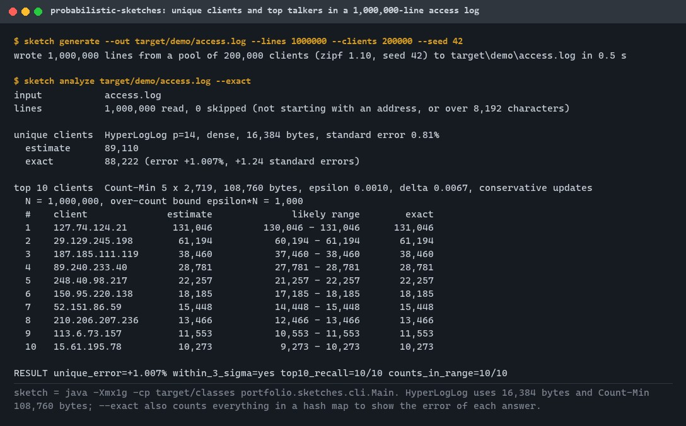
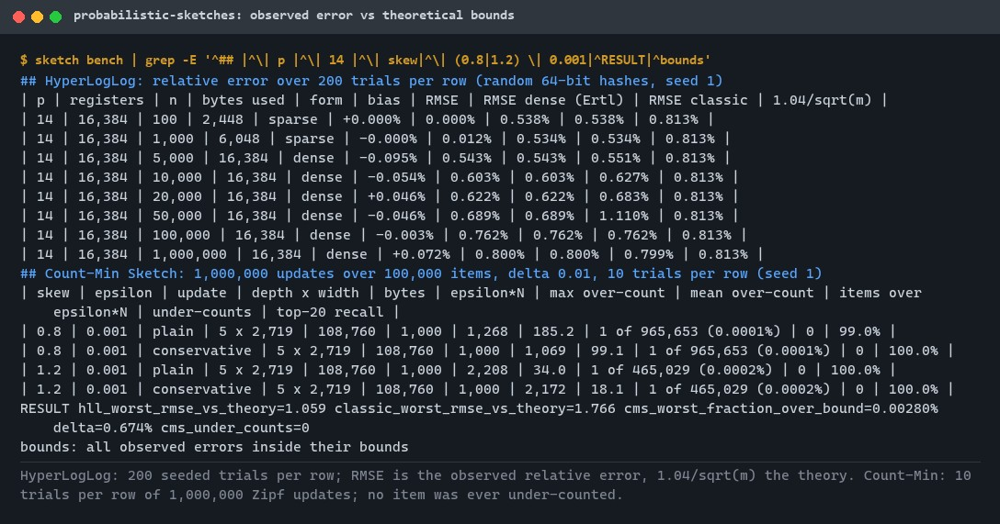
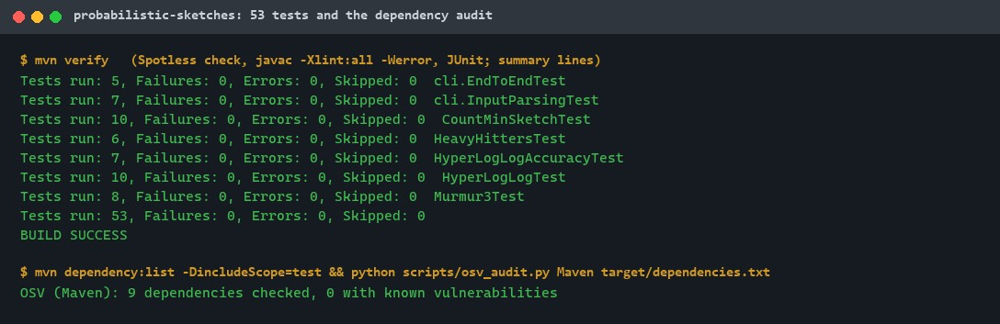
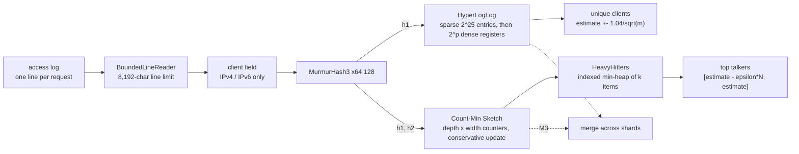
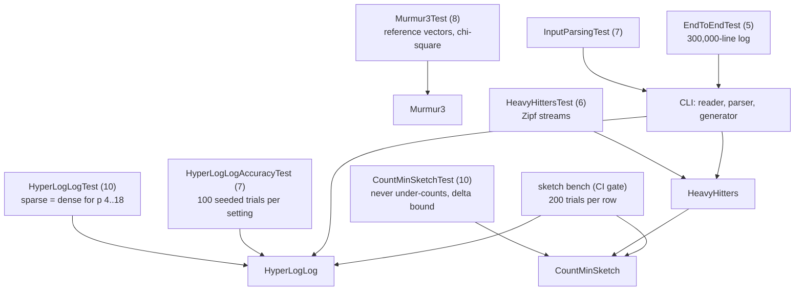

# probabilistic-sketches

[](https://github.com/EquinoxWN/probabilistic-sketches/actions/workflows/ci.yml)


> Count unique visitors or top items at massive scale in kilobytes, not gigabytes, with the error kept inside proven bounds.

Part of my **Distributed Systems & Storage** list · Java

## Proof it works

A synthetic access log of 1,000,000 requests from 88,222 distinct clients. HyperLogLog (16,384
bytes) estimates the unique clients within 1.01% (1.24 standard errors), and Count-Min Sketch
with a top-10 heap (108,760 bytes) finds exactly the true top 10 clients, each true count inside
the reported range:



Over 200 seeded trials per row, the observed HyperLogLog error stays within 6% of the theoretical
`1.04/sqrt(m)`, and across 5.7 million Count-Min estimates no item is ever under-counted:



53 tests pass, and no dependency has a known vulnerability:



## Architecture

**What M1 runs today:**



**Full roadmap (M1 to M3):**


## How it works

_Steps 1 and 2 are built and tested (M1); the rest is on the [roadmap](#roadmap)._

1. HyperLogLog hashes each item and uses runs of leading zeros to estimate distinct counts, switching from sparse to dense storage as it grows.
2. Count-Min Sketch keeps several hashed counter rows; the minimum is a frequency estimate with a known over-count bound, and a heap tracks heavy hitters.
3. Cuckoo filters store fingerprints and support deletes, which Bloom filters cannot; both are sized from a target false-positive rate.
4. t-digest clusters values with finer resolution at the tails, giving accurate p99 and p999 from a few kilobytes.
5. Every sketch is mergeable, so shards compute locally and combine results.
6. Tests run thousands of trials and assert the observed error sits within the published bounds.

In M1:

- **HyperLogLog** (`HyperLogLog`): the first `p` bits of a 64-bit MurmurHash3 pick one of
  `m = 2^p` registers, and the register keeps the longest run of leading zeros (plus one) in the
  remaining bits. A new sketch starts **sparse**, storing 4-byte entries of a finer 2^25-register
  sketch and counting them with linear counting (near exact for small sets); once that would use
  more memory than `m` bytes, it converts to dense registers. The conversion produces exactly the
  registers dense insertion would have, which a test checks for every precision from 4 to 18.
  The dense estimate uses Ertl's improved estimator, which has no error bump at the switch from
  linear counting (see [ADR 0002](docs/adr/0002-ertl-estimator-and-sparse-mode.md)).
- **Count-Min Sketch** (`CountMinSketch`): `depth = ceil(ln(1/delta))` rows of
  `width = ceil(e/epsilon)` counters. One 128-bit hash gives every row's position
  (`h1 + i*h2`). The estimate is the smallest of an item's counters, so it is never below the
  true count and, with probability `1 - delta`, at most `epsilon * N` above it. Conservative update
  is optional and on by default in the CLI; `halve()` ages all counters for TinyLFU-style use (see
  [ADR 0003](docs/adr/0003-double-hashing-and-conservative-update.md)).
- **Heavy hitters** (`HeavyHitters`): every update returns the item's new estimate; an indexed
  min-heap of `k` items keeps the largest. Reported entries carry the range
  `[estimate - ceil(epsilon*N), estimate]`.
- **CLI** (`portfolio.sketches.cli.Main`): `generate` writes a reproducible Zipf-distributed access
  log, `analyze` reports unique clients and top talkers (with `--exact`, next to exact counts),
  `bench` measures observed error against the bounds and exits with 3 if a bound is exceeded.

## Who it helps

- **Who:** Backend and data engineers who count distinct users, IPs or keys, or find the most
  frequent ones, in streams too large to keep every key in memory; and anyone learning how these
  sketches work.
- **The problem:** An exact distinct count or per-key counter map grows with the number of distinct
  keys (88,222 IPv4 addresses already need at least 352,888 bytes as packed 32-bit integers, before
  any hash-table overhead), while the answer is usually needed only to within a known error.
- **How to use it:** Run `sketch analyze access.log --exact` on a log whose first field is the
  client address to see the sketch answers next to exact counts, or use `HyperLogLog`,
  `CountMinSketch` and `HeavyHitters` from Java (no runtime dependencies). The size is chosen from
  the error you accept: `p = 14` gives 0.81% standard error in 16,384 bytes, and
  `epsilon = 0.001, delta = 0.01` gives a 0.1%-of-N over-count bound in 108,760 bytes.

## Tech stack

| Area | In M1 | Planned |
|---|---|---|
| Core | Java 21, MurmurHash3 x64 128, HyperLogLog (sparse + dense, Ertl estimator), Count-Min Sketch (conservative update, halving), top-k heap | Cuckoo and Bloom filters, t-digest (M2); merge for every sketch (M3) |
| Test | JUnit 6: reference hash vectors, seeded statistical trials against the theoretical bounds, CLI end to end; `sketch bench` gate in CI | Thousands of trials per sketch, JMH throughput benchmarks (M3) |
| Demo | CLI that generates a Zipf-distributed access log and reports unique clients and top talkers, with exact counts for comparison | Error-vs-memory charts with the theoretical bound drawn on top (M3) |
| Build | Maven, Enforcer (JDK 21+, Maven 3.9+), Spotless with palantir-java-format, `javac -Xlint:all -Werror`, OSV.dev dependency audit | - |

Language: **Java 21**, no runtime dependencies (JUnit for tests). Library code in
`src/main/java/portfolio/sketches/`, the command-line tool in `src/main/java/portfolio/sketches/cli/`.

## Run it

**Prerequisites:** JDK 21+ and Maven 3.9+ (Python 3 only for `make audit`).

```bash
make setup   # resolve dependencies
make lint    # enforcer, Spotless format check, javac -Xlint:all -Werror
make test    # 53 tests (about 10 seconds)
make demo    # 1,000,000-line log: sketch answers next to exact counts
make bench   # observed error vs theoretical bounds (about 20 seconds)
make audit   # OSV.dev check of every resolved dependency
make format  # rewrite sources in the project style
```

Without `make`: `mvn verify`, then for example

```bash
java -Xmx1g -cp target/classes portfolio.sketches.cli.Main generate --out target/demo/access.log --lines 1000000
java -Xmx1g -cp target/classes portfolio.sketches.cli.Main analyze target/demo/access.log --exact
```

`analyze` options: `--precision P` (4 to 18, default 14), `--epsilon E` (default 0.001),
`--delta D` (default 0.01), `--top K` (default 10), `--plain` (plain instead of conservative
updates), `--exact` (also count exactly, up to 5,000,000 distinct clients). `generate` never
overwrites an existing file.

### Use it from Java

```java
HyperLogLog visitors = new HyperLogLog(14);                // 16,384 bytes at most, 0.81% error
CountMinSketch counts = CountMinSketch.withErrorBounds(0.001, 0.01, true);
HeavyHitters top = new HeavyHitters(10, counts);

for (String ip : clientAddresses) {
    visitors.add(ip);
    top.add(ip);
}
long unique = visitors.cardinality();
for (HeavyHitters.Entry e : top.top()) {
    System.out.println(e.item() + " " + e.lowerBound() + ".." + e.estimate());
}
```

## Tests and results

Full numbers, commands and the DMAIC write-up: [docs/results/m1.md](docs/results/m1.md).

| Check | Result |
|---|---|
| Tests (`make test`) | **53 passed**, 0 failed |
| Lint | Spotless clean; `javac -Xlint:all -Werror` no warnings |
| Dependency audit (OSV.dev) | 9 dependencies (all JUnit, test scope), 0 known vulnerabilities |
| Demo: unique clients | estimate 89,110 vs exact 88,222 (+1.007%, +1.24 standard errors) in 16,384 bytes |
| Demo: top 10 clients | 10/10 of the true top 10, 10/10 true counts inside the reported range, 108,760 bytes |
| HyperLogLog bench | worst RMSE 1.059x the theoretical `1.04/sqrt(m)` over 24 settings x 200 trials |
| Ertl vs classic estimator | at `n = 10,000`, `p = 12`: RMSE 1.245% vs 2.870% (classic error bump at 2.5m) |
| Sparse mode | `p = 14`, 1,000 items: RMSE 0.012% in 6,048 bytes (dense: 0.534% in 16,384 bytes) |
| Count-Min bench | 0 under-counts in 5,722,728 estimates; at most 0.0028% of items over `epsilon*N` (bound: `delta` = 0.67%) |
| Mutation check | 10 deliberate bugs, each caught by 1 to 10 tests |

| Test class | Tests | What it proves |
|---|---|---|
| `Murmur3Test` | 8 | Matches the reference MurmurHash3 x64 128 on two published vectors and the empty input; `long` path equals hashing its 8 bytes; every byte of every length 1 to 48 changes the hash; the top 10 bits of both halves are uniform (chi-square) |
| `HyperLogLogTest` | 10 | Precision limits; duplicates change nothing; register = leading-zero run + 1; sparse memory never exceeds the dense size and switches once; sparse-to-dense conversion equals dense insertion for p = 4..18; small sets counted within 2 while sparse; 200,000 real strings within 3 standard errors; Ertl's sigma and tau match their series |
| `HyperLogLogAccuracyTest` | 7 | 100 seeded trials per setting: RMSE within 1.25x of `1.04/sqrt(m)` and no bias at n = 1,000 to 1,000,000 for p = 10, 12, 14; Ertl's estimator beats the classic one at 2.5m by at least 1.5x; sparse mode is at least 10x more accurate than dense for small sets |
| `CountMinSketchTest` | 10 | Width and depth from epsilon and delta; invalid arguments and total overflow rejected; never under-counts in either mode; fraction of items over `epsilon*N` stays below delta for depth 1 and 3; mean over-count of one row matches `(N - count)/w` within 3%; conservative estimates never exceed plain ones; halving; overloads hash the same bytes |
| `HeavyHittersTest` | 6 | Argument checks; exact order for few items; eviction of the smallest; an evicted item comes back; every item above `phi*N` reported on Zipf streams with its true count in range; top 10 equals the exact top 10 |
| `InputParsingTest` | 7 | Client field accepts only IPv4/IPv6 characters (up to 45); line reader handles CRLF, a missing final newline and oversized lines without holding them; Zipf sampler follows its distribution; generated addresses are distinct; option parsing rejects bad input |
| `EndToEndTest` | 5 | Generate then analyze 300,000 lines: unique count within 3 standard errors, top 10 recall 10/10, counts in range; RESULT line; deterministic generation; malformed, oversized and invalid UTF-8 lines skipped and counted; exit codes 0/1/2 and no overwrite |

### Test map



## Roadmap

**M1** (≈8 h)
- [x] Write `docs/rfc/0001-design.md`: problem, goals, non-goals, chosen design
- [x] HyperLogLog hashes each item and uses runs of leading zeros to estimate distinct counts, switching from sparse to dense storage as it grows.
- [x] Count-Min Sketch keeps several hashed counter rows; the minimum is a frequency estimate with a known over-count bound, and a heap tracks heavy hitters.

**M2** (≈8 h)
- [ ] Cuckoo filters store fingerprints and support deletes, which Bloom filters cannot; both are sized from a target false-positive rate.
- [ ] t-digest clusters values with finer resolution at the tails, giving accurate p99 and p999 from a few kilobytes.

**M3** (≈9 h)
- [ ] Every sketch is mergeable, so shards compute locally and combine results.
- [ ] Tests run thousands of trials and assert the observed error sits within the published bounds.
- [ ] Publish the proof below with real numbers

## Proof

What this repo must show before it counts as done:

- Error-vs-memory chart for each sketch with the theoretical bound drawn on top.

| Result | Value |
|---|---|
| M3 proof above | Not drawn yet (M3). The M1 error-vs-bound tables are in [docs/results/m1.md](docs/results/m1.md). |

## Why it matters

- **Interview angle:** 'Count unique visitors or top-k items at huge scale'.
- **Upstream I'm contributing to:** Apache DataSketches.

## Design docs

- [RFC 0001: design](docs/rfc/0001-design.md)
- [ADR 0001: record architecture decisions](docs/adr/0001-record-architecture-decisions.md)
- [ADR 0002: Ertl's estimator and an exact sparse-to-dense conversion](docs/adr/0002-ertl-estimator-and-sparse-mode.md)
- [ADR 0003: double hashing and conservative update in Count-Min](docs/adr/0003-double-hashing-and-conservative-update.md)
- [M1 results](docs/results/m1.md)

## Scope

This is a learning and portfolio system, not a hosted production service. Everything runs locally.

## Security and contributing

- Every GitHub Action is pinned to a commit SHA; workflows run read-only, without persisted credentials.
- Dependabot update pull requests are paused (`open-pull-requests-limit: 0`) so the repository keeps a single `main` branch; dependencies are updated by hand and checked by the CI audit; CI checks every resolved dependency against OSV.dev.
- CI fails on a formatting or compiler warning, a failing test, a demo answer outside its bound, or a bench result outside its bound.
- Inputs are bounded: 8,192 characters per log line, 45 per client field, sketch sizes and option ranges checked, and `--exact` stops at 5,000,000 distinct clients.
- Report vulnerabilities privately: see [SECURITY.md](SECURITY.md). To contribute, see [CONTRIBUTING.md](CONTRIBUTING.md).

## License

MIT, see [LICENSE](LICENSE).
