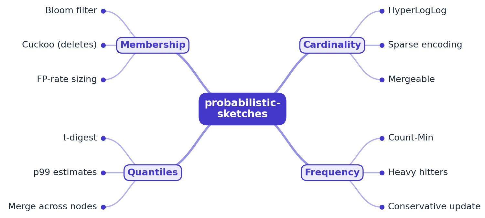

# RFC 0001: probabilistic-sketches design

- **Status:** Accepted (M1 implemented)
- **Author:** EquinoxWN
- **Created:** 2026

## Problem

Two questions come up in every system with traffic: *how many distinct users (IPs, devices,
keys) did we see?* and *which ones are the most frequent?* Answering them exactly means keeping
every distinct key: a hash set or a key-to-count map that grows with the number of distinct keys,
has to be held per shard, per time window and per dimension, and cannot be combined cheaply. At
millions of distinct keys per window this is gigabytes of memory for an answer that is usually
needed only to within a percent or so.

Probabilistic sketches answer the same questions in a fixed, small amount of memory chosen in
advance from the error the user accepts, and the error has a published bound. This project builds
those sketches from first principles in plain Java, measures the observed error against the
theoretical bound, and makes the bound visible in every answer.

**Users:** backend and data engineers who count distinct users or keys and find heavy hitters in
logs and streams; the cache-eviction-lab repository, which will reuse the Count-Min Sketch as the
TinyLFU admission filter; and people learning how these structures work.

## Critical-to-quality measures (Define)

| CTQ | Measure | Target (M1) |
|---|---|---|
| Distinct-count accuracy | RMSE of `estimate / n - 1` over seeded trials, for p = 10, 12, 14 and n from 100 to 1,000,000 | at most 1.25 x `1.04/sqrt(m)` in every setting |
| Distinct-count bias | mean of `estimate / n - 1` | within 3 standard errors of the mean, plus 0.1 x `1.04/sqrt(m)` |
| Small-set accuracy | absolute error while the sketch is sparse (p = 14, n up to 3,000) | at most 2 |
| Distinct-count memory | bytes used, for any n | at most `2^p` bytes (16,384 at p = 14); sparse form never above that |
| Frequency safety | items whose estimate is below the true count | 0, always |
| Frequency accuracy | fraction of items over-counted by more than `epsilon * N` | at most `delta` |
| Heavy hitters | items with true count at least `phi * N` that are missing from the report | 0 on seeded Zipf streams |
| Robustness | crash or unbounded memory on malformed input | none: every input bounded and validated |
| Build quality | compiler warnings, format violations, known-vulnerable dependencies | 0 |

## Goals

- **HyperLogLog** with a sparse representation for small sets and dense `2^p` registers for large
  ones, switching automatically when the sparse form would need more memory than the dense one.
- **Count-Min Sketch** sized from `(epsilon, delta)`, with the never-under-count guarantee, optional
  conservative update, and periodic halving for frequency aging.
- **Heavy hitters**: a top-k heap over the Count-Min estimates, reporting a likely range for each
  item.
- A **command-line tool** that runs both on a web access log and, on request, prints exact counts
  next to the sketch answers, and a **bench** that measures observed error against the bounds and
  fails when a bound is exceeded.
- Later: Cuckoo and Bloom filters and t-digest (M2); merge for every sketch, thousands of trials
  per sketch and error-vs-memory charts (M3).

## Non-goals

- A drop-in replacement for Apache DataSketches: no serialization format, no off-heap memory, no
  compatibility with other libraries' binary layouts in M1.
- Thread safety: each sketch is single-writer; concurrent use needs one sketch per thread and a
  merge (M3).
- Negative updates (turnstile streams): Count-Min here accepts only non-negative counts, which is
  what conservative update and the never-under-count guarantee need.
- Running as a hosted production service.

## Proposed design

### Hashing

Every sketch hashes its items with MurmurHash3 x64 128 (public-domain reference algorithm,
implemented here and checked against published vectors). Strings are hashed as UTF-8 and longs as
their 8 little-endian bytes. HyperLogLog uses the first 64-bit half; Count-Min uses both halves.

### HyperLogLog

- Precision `p` from 4 to 18, `m = 2^p` registers. Register index = top `p` bits of the hash;
  register value = number of leading zeros in the remaining `64 - p` bits, plus one (at most
  `65 - p`). Registers are bytes; 6-bit packing would save 25% and is left out for clarity.
- **Sparse form** (after Heule, Nunkesser and Hall, "HyperLogLog in Practice", 2013): each hash is
  encoded as a 31-bit int `(top 25 bits << 6) | run length of the other 39 bits`. New entries go
  into a buffer of `m/32` ints; when it is full it is sorted and merged into a sorted list that
  keeps the largest run per index. The estimate is linear counting over `2^25` buckets, which is
  near exact while the list is small. When `4 * (entries + buffer) > m`, the list is converted to
  dense registers; the conversion derives each dense register exactly as dense insertion would
  (proof in ADR 0002), so switching adds no error.
- **Dense estimate:** Ertl's improved estimator (2017), computed from the register histogram with
  the `sigma` and `tau` series. It needs no empirical bias tables and has no switch between linear
  counting and the raw estimate. The classic estimator is kept as `classicEstimate()` to measure
  the difference.

### Count-Min Sketch and heavy hitters

- `width = ceil(e / epsilon)`, `depth = ceil(ln(1 / delta))`, one flat `long[]` of
  `depth * width` counters (at most 2^24). Row `i` uses position
  `unsignedMultiplyHigh(h1 + i * h2, width)`.
- Plain update adds the count to one counter per row; conservative update raises each counter only
  to `min + count`. The estimate is the minimum. `halve()` shifts every counter right by one.
- `HeavyHitters` keeps an indexed binary min-heap of at most `k` items (array plus item-to-slot
  map, so an update is O(log k)). `add` updates the sketch, then raises the item in the heap,
  inserts it, or replaces the minimum if the new estimate is larger. `top()` re-reads every heap
  item's estimate before reporting.

### Command-line tool

`generate` writes a Common Log Format file with Zipf-distributed client addresses (seeded, never
overwrites); `analyze` streams a log through a bounded line reader, accepts only first fields made
of IPv4/IPv6 characters, and prints the sketch answers (and exact counts with `--exact`); `bench`
prints the measurement tables below and exits with 3 if a bound is exceeded.

## Alternatives considered

| Option | Why not (yet) |
|---|---|
| Use Apache DataSketches or Guava as a dependency | The point of the project is to build and measure the algorithms; DataSketches is the upstream to compare against and contribute to later, not a dependency. Guava's hashing would add a 3 MB dependency for one hash function. |
| HyperLogLog++ empirical bias correction (Google's tables of ~200 points per precision) | Needs large data tables per precision and an interpolation step; Ertl's estimator reaches the same goal (no error bump at small and middle ranges) with two short series, and the bench shows it at or below the theoretical error everywhere it was measured. See ADR 0002. |
| Sparse form at the same precision as the dense registers (no 2^25 index) | Simpler conversion, but the sparse estimate would be no better than dense linear counting; the 25-bit form makes small sets near exact (RMSE 0.012% at 1,000 items vs 0.534% dense). |
| Count-Mean-Min or Count Sketch (signed counters, median estimate) | Unbiased and better for heavy-tailed noise, but can under-count, which breaks the "never below the true count" guarantee that heavy hitters and TinyLFU rely on. |
| Space-Saving / Misra-Gries for top-k | Deterministic error bounds and no hashing, but they only track k items; Count-Min also answers the frequency of any item, which TinyLFU needs. The heap over Count-Min gets both. |
| `d` independent hash functions for Count-Min | `d` hash computations per update; one 128-bit hash with double hashing costs one. See ADR 0003. |

## Measurement plan (Measure, Analyze, Control)

- **Method:** `sketch bench` feeds seeded random 64-bit hashes (an ideal hash) into HyperLogLog at
  p = 10, 12, 14 and checkpoints n = 100 to 1,000,000, 200 trials per row, recording bias, RMSE
  of the default sketch, RMSE of the dense sketch with Ertl's and the classic estimator, and bytes
  used. For Count-Min it runs 1,000,000 Zipf-distributed updates (skew 0.8 and 1.2) over 100,000
  items, 10 trials per row, at epsilon 0.01 and 0.001 with plain and conservative update, and
  records max and mean over-count, the fraction of items over `epsilon * N`, under-counts and top-20
  recall. MurmurHash3 itself is checked separately (reference vectors, chi-square).
- **End to end:** `sketch analyze --exact` on a generated 1,000,000-line log compares both sketches
  with exact counts.
- **Control:** the CTQ targets are unit-test assertions (`HyperLogLogAccuracyTest`,
  `CountMinSketchTest`, `HeavyHittersTest`), and CI runs the demo and the bench and fails when
  their RESULT lines leave the bounds.
- **M3:** thousands of trials per sketch and error-vs-memory charts with the bound drawn on top.

## Milestones

- **M1:** HyperLogLog with sparse and dense storage; Count-Min Sketch with heavy hitters; CLI,
  bench and tests. Done.
- **M2:** Cuckoo filters with deletes and Bloom filters, both sized from a target false-positive
  rate; t-digest for p99 and p999.
- **M3:** Merge for every sketch; thousands of trials per sketch against the published bounds;
  error-vs-memory charts.

## Risks and open questions

- **Hash quality is assumed by every bound.** MurmurHash3 is not cryptographic: an adversary who
  knows the (fixed) seed can craft keys that collide and inflate one item's Count-Min estimate or
  skew HyperLogLog. A per-deployment random seed would block this; M1 keeps a fixed seed so
  results are reproducible, and documents the limitation in SECURITY.md.
- **Double hashing weakens the independence the Count-Min proof assumes.** Measured over-count
  stayed far below the bound (ADR 0003), but the proof is for pairwise-independent rows.
- **The bench uses ideal random hashes for HyperLogLog**, so it measures the estimator, not the
  hash; the end-to-end demo and `realStringItemsLandWithinThreeStandardErrors` cover real strings.
- **Small register counts:** at p = 10 the observed RMSE (up to 3.44%) is slightly above
  `1.04/sqrt(m)` (3.25%), as expected for small `m`; the CTQ target allows 25%.
